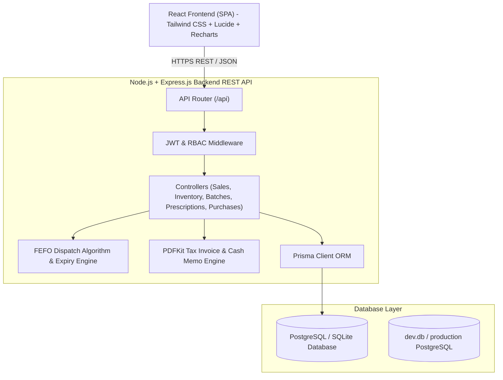

# System Architecture & Core Pharmacy Workflows
## Pharmaceutical Management System (PMS)

---

### 1. High-Level Modular Monolithic Architecture

---

### 2. Core Pharmacy Business Workflow

As specified in the PMS blueprint, the operational flow follows an unbroken chain of custody:

```mermaid
flowchart LR
    A["1. Procurement (PO Creation)"] --> B["2. Goods Receiving & Physical Inspection"]
    B --> C["3. Inventory Update (Batch Creation + FEFO Queuing)"]
    C --> D["4. Prescription Verification (Schedule H/H1/X Checks)"]
    D --> E["5. Point of Sale (POS Billing & Price Capping)"]
    E --> F["6. Automatic Stock Deduction (FEFO + Stock Audit Movement)"]
    F --> G["7. Statutory Register Logging (Schedule H1 Log)"]
    G --> H["8. Analytics & Financial Reporting"]
```

---

### 3. First Expiry, First Out (FEFO) Dispatch Algorithm

1. **Query Active Batches**: For requested `medicineId`, retrieve batches where `currentQuantity > 0`, `status IN ('ACTIVE', 'NEAR_EXPIRY')`, and `expiryDate > CURRENT_DATE`.
2. **Order Ascending**: Sort by `expiryDate ASC` so that earliest expiring lot is prioritized.
3. **Validation Gates**:
   - Reject any batch where `status = 'EXPIRED'` or `expiryDate <= NOW()`.
   - Reject any batch where `status = 'RECALLED'` (manufacturer quality notice).
   - Reject any batch where `status = 'BLOCKED'`.
4. **Price Cap Validation**: Verify `sellingPrice <= batch.mrp` (Drugs Prices Control Order enforcement).
5. **Atomic Allocation**: In a single database transaction, decrement batch quantity and insert append-only `StockMovement` row with `movementType = 'SALE_DEDUCTION'`.

