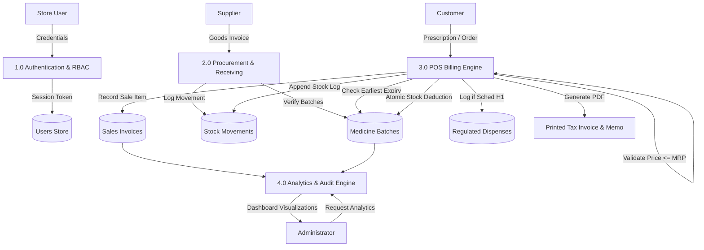

# Data Flow Diagrams (DFD)
## Pharmaceutical Management System (PMS)

### Level 0 DFD (Context Diagram)

```mermaid
flowchart TD
    Supplier["Supplier / Wholesaler"] -->|Delivery Challan & Batch Invoices| PMS["Pharmaceutical Management System (PMS)"]
    PMS -->|Purchase Orders & Payment Invoices| Supplier

    Doctor["Medical Practitioner"] -->|Prescription Orders| PMS
    
    Customer["Customer / Patient"] -->|Prescription & Medicine Request| PMS
    PMS -->|Cash Memo, Medicines & Tax Invoice| Customer

    Pharmacist["Pharmacist / Cashier"] -->|Dispensing Operations & Verification| PMS
    PMS -->|FEFO Batch Selection & Regulatory Alerts| Pharmacist

    DrugInspector["Drug Control Authority"] <--|Schedule H1 Register & Expiry Logs| PMS
```

---

### Level 1 DFD (Major Functional Processes)



