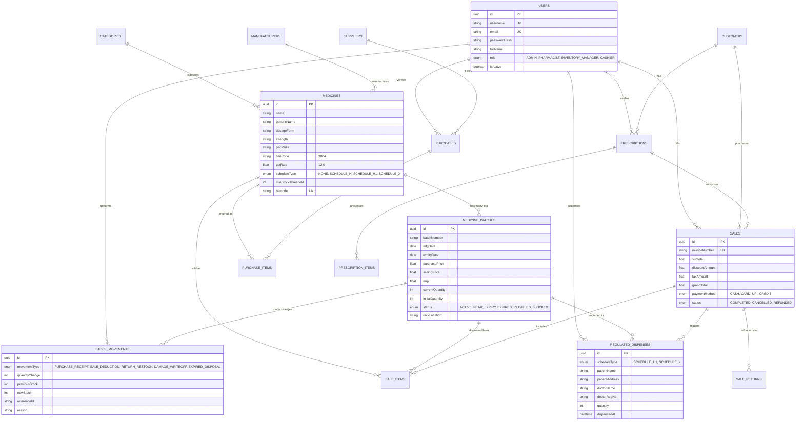

# Entity Relationship (ER) Diagram
## Pharmaceutical Management System (PMS)

The PMS database schema is relational, strongly typed, and normalized to ensure inventory consistency, batch segregation, and regulatory compliance under the Drugs and Cosmetics Act.

